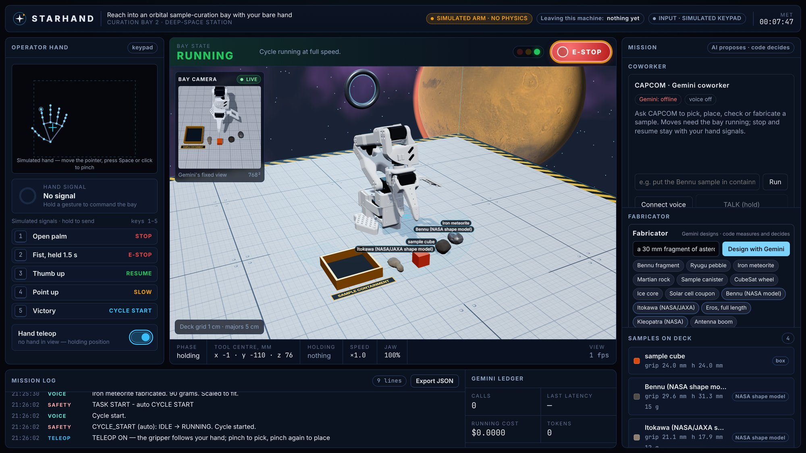
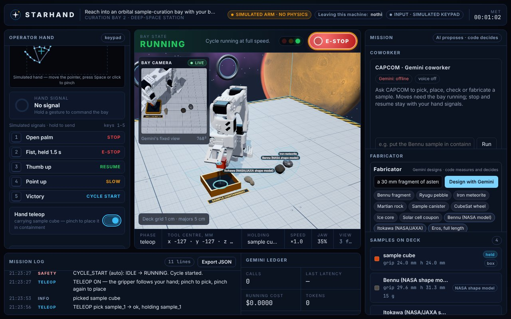
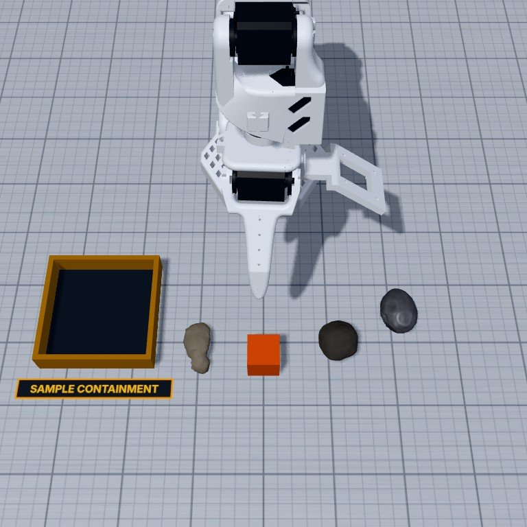

# STARHAND

Reach into an orbital sample-curation bay with your bare hand.

STARHAND is a browser simulation of a sample-curation bay on a deep-space station:

- **Your hand:** the webcam tracks it with MediaPipe on your own device, and a simulated SO-101 robot arm follows it. Pinch once to pick up the asteroid sample under the gripper; pinch again to put it down.
- **Gemini:** designs new samples, such as meteorites, canisters and CubeSat parts. Gemini Robotics-ER checks the bay through a fixed camera.
- **Code:** measures every sample against what the real gripper can hold, scales it to fit or refuses it, and says why.
- **ElevenLabs:** is mission control's voice.
- **Safety:** open palm stops the arm and a held fist is an emergency stop. Hand signals always override AI.

Built at UB Hacking 2026 (November 7–8). Every line of code was written during the event; see [PROVENANCE.md](PROVENANCE.md) for disclosures and credits. Architecture: [docs/ARCHITECTURE.md](docs/ARCHITECTURE.md).

> **Status:** under construction during the hackathon. The arm is a kinematic simulation, not a real robot.



| Hand teleop: carrying a sample to containment | What Gemini Robotics-ER sees (fixed bay camera) |
| --- | --- |
|  |  |

## How it works

### Hand teleop: you say where and when, the arm's checked code does the rest

Turn on **Hand teleop** and the gripper follows your hand over the bay deck. A cyan ring on the deck shows where it is heading.

- **To pick up a sample:** hover over it and pinch your thumb and index finger together once.
- **To put it down:** move to where you want it, or over the containment bin, and pinch again.

Your hand only sets the target. The arm's own checked code plans the exact descent, sets the grip width and confirms the sample is held. With no hand in view, the arm holds still.

No webcam? An on-screen pad stands in for your hand: move the mouse to steer and press Space to pinch.

### The Fabricator: Gemini proposes, code decides

You describe a sample, such as "an iron meteorite, about five centimetres". Gemini answers with a small JSON shape program: rocks, lathes, extrusions and other primitives, plus a material. Code then does the rest:

1. Clamps every number and builds one mesh.
2. Measures it the way the SO-101's jaw would meet it: the narrowest width the jaw closes on, the height, the footprint, and the mass from densities set by code.
3. Scales it uniformly to fit the arm: grip width 15–45 mm, height up to 45 mm, mass up to 100 g. If no scale fits, it refuses with a sentence mission control can read out.
4. Turns the narrow side onto the jaw's closing axis, so every sample that reaches the deck can actually be grasped.

If the sample is refused, Gemini gets one repair attempt using that sentence; after that, the closest preset is used. The real NASA shape models of Bennu, Itokawa, Eros and Kleopatra are presets too, scaled down from kilometres to millimetres.

### Safety: hand signals always win

| Signal | Effect |
| --- | --- |
| Open palm, held about 0.6 s | STOP: the arm freezes where it is |
| Thumbs-up | RESUME |
| Fist held 1.5 s | EMERGENCY STOP: every move is aborted; a two-step reset on screen is needed |
| Index finger up | SLOW: half speed |
| V sign | CYCLE START |

AI can never start, stop, resume or reset the bay. Precedence is: hand signals, then the on-screen panel, then the code gate, then AI.

## What is real and what is simulated

- **Real:**
  - your hand tracking (on your device)
  - your voice
  - the Gemini and ElevenLabs calls
  - the SO-101 geometry and joint limits (MuJoCo Menagerie)
  - the NASA asteroid shape models
- **Simulated:** the arm is a kinematic simulation with no physics. It is not a real robot. Samples attach to the jaw by rule, and their masses come from assumed densities.

## Run it

```bash
git clone https://github.com/ahmedsohail2003/buffalo-hackathon
cd buffalo-hackathon
npm ci
npm run dev                  # open http://localhost:5173/?sim=1 for the simulated hand (no camera, no keys)
```

### Real voice and AI (local)

1. Copy the example settings:

   ```bash
   cp .env.example .env.local
   ```

2. Fill in the keys in `.env.local`:
   - `GEMINI_API_KEY` and `ELEVENLABS_API_KEY`, for the server.
   - `VITE_GEMINI_API_KEY` (optional): lets the browser call Gemini directly. Use it on your own laptop only.

3. Start the server in one terminal:

   ```bash
   npm run server
   ```

4. Start the app in a second terminal:

   ```bash
   npm run dev
   ```

5. Open http://localhost:5173 in Chrome. Allow the camera, then click **Enable camera** to use your real hand. **Connect voice** turns on Gemini Live with the ElevenLabs voice.

### Public deploy

See [deploy/vultr/README.md](deploy/vultr/README.md): one VPS with Caddy for HTTPS. The keys live only on the server.

## Development

```bash
npm install
npm run dev        # http://localhost:5173  (?sim=1 forces the simulated hand)
npm test           # vitest: arm core, teleop, Fabricator and the cross-module tests on the real SO-101 model
npm run build
```

## Private files

This repository is public, including its commit history. Git ignores the locations below, so files in them are never committed or pushed:

| Location | Examples |
| --- | --- |
| Any folder named `private`, at any depth | `private/notes.md`, `src/private/data.csv` |
| Any file with `.private.` in its name | `pitch.private.md` |
| `.env` and `.env.*`, except `.env.example` | `.env`, `.env.local` |

Everything else can be committed and published.

This repo does not back up or share private files. The top-level `private/` folder is backed up separately to a private repo. Other private files exist only on the computer that holds them.

To check a file before you commit it, run this command. If it prints a matching rule, the file is private. If it prints nothing, the file can be published.

```bash
git check-ignore -v path/to/file
```
