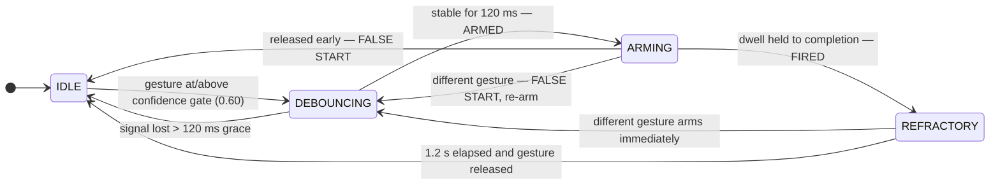
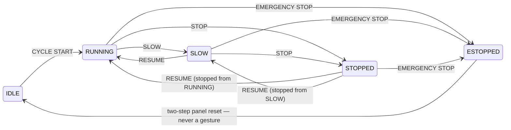

# The cell — a robot work cell you instruct the way you'd instruct a coworker

**A simulated SO-ARM100 work cell in the browser. You talk to it; Gemini sees,
plans and verifies; hand gestures recognised on-device remain the safety
channel and override everything.** EmberHacks 2026 build.

Gemini 3.8 Live is the coworker's voice: it listens on hold-to-talk, asks one
question when a request is ambiguous, negotiates part sizes, and hands tasks
to Gemini Robotics-ER 2, its eyes. ER looks at the fixed cell camera, points
at the part you named (its localization error against the registry is shown
in millimetres), plans, drives the arm through validated tool calls and
verifies every step from a fresh frame before continuing. Gemini 3.8 Flash
runs the same coworker over typed text.

Code is the trust boundary: every tool call passes a cell-state gate, a size
and reach validator and an IK pre-check before anything moves, and rejections
come back as sentences the voice can say. Hand gestures (MediaPipe, on-device)
are the safety channel: open palm freezes the arm mid-move and pauses the
task, thumbs-up resumes it, a held fist e-stops and aborts; Gemini's motion
tools are refused while the cell is stopped. Every model call is on screen
with model, thinking level, latency, tokens and cost.

The gesture layer is HandSignal, a pre-existing prototype grounded in the
**ASME B30.5 crane signalperson signals** (STOP, EMERGENCY STOP, RESUME,
SLOW MODE, CYCLE START); see [Provenance](#provenance) for exactly what
existed before the hackathon and what was built today.

Built with Vite + React + TypeScript + three.js. Gesture recognition runs
on-device via MediaPipe's GestureRecognizer; a pure-TypeScript safety state
machine sits between recognition and the cell; browser FK/IK for the arm are
validated against MuJoCo fixtures (see [Development](#development) for the
test count).

## Try it in 60 seconds

```bash
npm install
npm run dev      # then open the printed URL
```

- **No camera needed.** Simulated input is a first-class mode (and the
  default when no camera is present): hold keys **1–5**, or press and hold the
  on-screen signal keypad, to send a gesture through the exact same pipeline
  the camera feeds. Everything simulated is labeled as simulated.
- **Guided demo.** Click **Guided demo · 45 s** (or open `?demo=1`) for a
  scripted, captioned story: cycle start → slow → stop → resume → e-stop →
  two-step reset. Press any gesture key to take over mid-demo.
- **Camera mode** is strictly opt-in: click **Enable camera** to lazy-load
  MediaPipe and drive the cell with your own hand.
- `?sim=1` forces simulated input.

## Run it

```bash
npm ci
copy .env.example .env.local      # then put your Gemini API key in .env.local
npm run dev                       # Chrome, http://localhost:5173 — allow mic (+ camera if you want live gestures)
```

`?sim=1` forces simulated gesture input (keys 1–5), `?present=1` is the
projector layout, `?demo=1` plays the guided gesture demo. Typed tasks work
without a microphone (Coworker column, "Run"); voice needs Connect + hold
TALK.

> **Warning.** `VITE_GEMINI_API_KEY` is inlined into the browser bundle: the
> key is visible to anyone who can load the page. This is a local demo
> build — never deploy `dist/` publicly, and use an API key restricted to the
> Gemini API only.

## How Gemini is used

| Model | Job |
| --- | --- |
| `gemini-3.8-live` | Ears and voice of the coworker: hold-to-talk 16 kHz PCM in, 24 kHz audio out, clarifying questions, tools `run_task`, `create_object`, `decorate_object`, `point_at`, `describe_scene`, `cell_status`, `cancel_task`, `remove_object`. Interprets "add a blue cylinder 30 mm wide to the right of the red block" into a validated part spec and reads the size back; negotiates when a spec is rejected. `run_task` is `NON_BLOCKING`: acknowledged at once, completion arrives as a `[CELL EVENT]`. |
| `gemini-robotics-er-2-preview` | Eyes and planner: points at parts on rendered 768² cell-camera frames (localization error vs the registry in mm, typically 1 mm), plans and acts through function calling one tool call at a time with a fresh frame after every action, verifies each step from that frame, narrates its plan (thought summary shown as "ER thinks" and spoken by Live), and judges grasp feasibility on every created part. In demo mode it sees only high-level tools (`pick`, `place_in_tray`, `place_at`, `home`, `done`). Tool results are authoritative for what happened; ER's frame verdict is advisory and disagreements are shown as `DISAGREE` lines, never hidden. Thinking levels: plan HIGH (measured 1.1–2.8 s), act/verify/point LOW, grasp MEDIUM. |
| `gemini-3.8-flash` | The same coworker over typed text with the same tool declarations; fallback brain for voice and for ER if the preview model is unavailable. |
| `gemini-3.1-flash-lite-image` (Nano Banana 2 Lite) | Prints a generated image (label, part number, logo, hazard stripes) onto a part's faces on request (`decorate_object`, ~2.6 s, ≈$0.02). The print renders into the cell camera, so ER points at "the part with a printed pattern"; at ~40 px per part it cannot read *which* print, an honest limit of the camera scale. |

Actual model used for planning today: `gemini-robotics-er-2-preview`.
DEMO_MODE: `planLevel=HIGH`, `consensusN=1`, `fcShape=A` (image inside
`functionResponse.parts`), `pointSchema=ON` (`responseJsonSchema`),
`highLevelOnly=true`, `attachRadius=15 mm`. Fallbacks taken today: none.

There is no physics engine. Parts snap to the gripper when the jaw closes within
15 mm of them, and a released part rests on the tray floor, the table, or the top
of the part beneath it, so parts can be stacked ("put the red block on top of the
blue cylinder": 6 model calls, $0.02).

Every call is on screen: the telemetry strip's "Gemini in the loop" cell
(phase, step, last model · level · latency, running cost), the Coworker
ledger (model, purpose, level, ms, prompt/output/thought tokens, $), the
plan card (steps ✓/✗ with the verify observation), a "What Gemini sees"
thumbnail (ER points in yellow, registry ground truth in green, error in mm),
and the top-bar egress badge. The exported JSON contains every `GeminiCallEntry`.

## What leaves this machine

Microphone audio while TALK is held in a connected voice session (Gemini
Live); rendered cell-camera frames during tasks (Gemini Robotics-ER); nothing
else. Gesture recognition stays on-device. Webcam frames never leave this
machine in this build. HandSignal previously stated all processing was
on-device; that is no longer true here and the top-bar counters say so. The
API key lives in this browser build; never deploy `dist/`.

## Provenance

> **Pre-existing before EmberHacks:** the HandSignal app (webcam gesture
> recognition, gesture state machine, cobot cell state model, telemetry,
> guided demo and its 28 tests; github.com/ahmedsohail2003/handsignal, commit
> `a8d643b99d90355c67cf607fd721cf40c35d40a3`); the SO-ARM100 meshes, joint
> data and keyframes vendored from my portfolio work-cell page (commit
> `04e4c25a55c17bf8d49731027f25156532d23a58`; meshes from MuJoCo Menagerie
> `trs_so_arm100`, Apache-2.0); the damped-least-squares IK formulation from
> my `workcell-partA-imitation` MuJoCo project (commit
> `5822ac1dd508c92183fd8ecc99f91d6ec386549b`). **Built during the hackathon:**
> the three.js cell inside HandSignal, browser FK/IK validated against MuJoCo
> fixtures generated today (heights re-derived for a kinematic arm: grasp
> 27 mm instead of the physics-stalled 15 mm, retreat 90 mm instead of the
> unreachable 120 mm), the motion executor and pick/place primitives, the
> object registry and validator, the fixed cell camera with ER point
> un-projection, all Gemini integration (Live voice, Robotics-ER
> pointing/planning/verification, Flash text path, telemetry and cost
> accounting), the coworker console, and these disclosures. There is no
> physics: parts snap to the gripper when the jaw closes within 15 mm of
> them. Nothing here controls a real robot. Fallbacks taken today: see
> PROGRESS.md "Fallbacks".

Commit 0 of this repository (`6db4f7f`) is the vendored pre-existing state;
everything after it was built during the event. Compare with
`git diff 6db4f7f..HEAD`. Third-party licences are listed in
[THIRD_PARTY_LICENSES.md](THIRD_PARTY_LICENSES.md).

## Gesture vocabulary

| Key | Hand signal (recognized pose) | Crane-signal origin (ASME B30.5) | Adapted meaning in the cell |
| --- | --- | --- | --- |
| 1 | Open palm (`Open_Palm`) | **STOP** — open hand, palm out; the one literal match | **STOP** — pause motion exactly where it is |
| 2 | Closed fist, held 1.5 s (`Closed_Fist`) | Adapted from **"dog everything"** (clasped hands = halt all operations) | **EMERGENCY STOP** — lockout; on-screen two-step reset required |
| 3 | Thumb up (`Thumb_Up`) | Not a B30.5 signal — universal confirm gesture | **RESUME** — return to the state the cell was stopped in |
| 4 | Index finger up (`Pointing_Up`) | Adapted from the **"move slowly"** hand-over-signal modifier | **SLOW MODE** — motion at 50% speed |
| 5 | V sign (`Victory`) | No crane equivalent — chosen as a visually distinct pose | **CYCLE START** — begin a cycle, from IDLE only |

Only the open-palm STOP is a literal borrowing; the other four are labeled
adaptations (in the UI keypad, the About panel, and here). See
[Honest limitations](#honest-limitations) for why.

## Safety interaction design

A recognized pose is never a command by itself. Every classification — real or
simulated — passes through the same pipeline in
`src/gesture/stateMachine.ts`:

```
raw classification → confidence gate → debounce → dwell arming → fire → refractory
```



Design decisions worth defending in a crit:

- **Dwell, not toggling.** A command is a deliberate hold with a filling ring
  (600 ms default, adjustable 300–1200 ms), never a passing pose. The ring is
  also an abort affordance: drop the hand before it closes and nothing fires
  (logged as a false start).
- **Asymmetric costs.** Stopping is cheap (600 ms). EMERGENCY STOP requires a
  fixed 1.5 s hold — a false e-stop halts production, so it must cost more
  intent.
- **Refractory is per-gesture, not global.** A held gesture fires exactly
  once — repeating it requires the gesture to be released AND its refractory
  period to elapse — but a *different* gesture can arm immediately — a STOP
  is never queued behind a RESUME's refractory window.
- **E-stop recovery is not gesture-driven.** Reset is a deliberate two-step
  act on the panel (reset, then confirm) and returns the cell only to IDLE — a
  fresh CYCLE START is required. A misread pose must never re-energize a
  locked-out cell: gestures can only make the cell safer.

The simulated cell itself is a small tested state machine
(`src/cell/cellSim.ts`):




## Research question and measures

> Can a standardized industrial hand-signal vocabulary serve as a reliable,
> learnable command channel for cobot cells, and what dwell time best trades
> false activations against responsiveness?

Every raw detection, armed event, fired command, and false start is
timestamped, shown in the telemetry strip, and exportable as JSON. Those logs
directly yield the dependent measures a dwell-time study needs:

| Measure | From the log |
| --- | --- |
| False-activation rate | Fired commands the participant did not intend (post-task review against task instructions) |
| False-start rate | Armed-but-released-early events per command — dwell set too long, or unstable recognition |
| Dwell-to-fire latency | First raw detection → fire, per gesture and per dwell setting |
| Refractory collisions | Raw detections with no arming during refractory — pacing friction |
| Learnability | Change in false starts and latency across task blocks |

Planned design: within-subjects, dwell at 400 / 600 / 900 ms
(counterbalanced), tasks mixing urgent stops with routine starts; a
signal-detection framing where dwell trades hits against false alarms.

**Status: [Evaluation designed; sessions pending].** No participants have been
run and no findings exist; nothing in the prototype or this document reports
study data. Full study design and rationale live in
[`docs/DESIGN-NOTES.md`](docs/DESIGN-NOTES.md).

## Honest limitations

- **Canonical poses as stand-ins.** The recognizer is MediaPipe's stock
  GestureRecognizer, so the vocabulary is constrained to its canonical static
  single-hand poses. Real B30.5 signals are largely *dynamic* (swinging
  forearms, circular motions) and sometimes two-handed. A production system
  would train recognizers on the actual dynamic signals; the claim under test
  here is the *approach* — borrowing an existing industrial gesture language
  and gating it behind dwell/debounce/refractory — not that these five static
  poses are the B30.5 standard.
- **The cell is kinematic, not physical.** The robot is a 3D SO-ARM100
  (MuJoCo Menagerie meshes) driven by browser FK/IK validated against MuJoCo
  fixtures, labeled "3D kinematic model — SO-ARM100 meshes, no physics, not a
  real robot" in the UI. There is no physics: parts snap to the gripper when
  the jaw closes within 15 mm of them. Nothing here controls a real robot.
- **Simulated input is labeled.** Keyboard/keypad input injects synthetic
  classifications with an adjustable synthetic confidence; the UI badge reads
  SIMULATED INPUT whenever it is active. Downstream of the classifier, the
  code path is identical for both inputs, so state-machine findings from the
  simulator transfer.
- **Privacy.** Gesture recognition stays on-device (MediaPipe). While a voice
  session is connected and TALK is held, microphone audio streams to Gemini
  Live; rendered cell-camera frames go to Gemini Robotics-ER during tasks.
  Webcam frames never leave this machine in this build. Nothing is recorded
  by this app. The counters in the top bar show exactly what has left this
  machine. The MediaPipe runtime and model are fetched from the official CDN
  at the moment you opt in to camera mode.


## Development

```bash
npm install
npm run dev        # development server
npm test           # vitest — 71 tests: gesture state machine, cell, demo script, arm FK/IK/controller/camera, object validator, Gemini ER/loop/bus
npm run build      # type-check + production build
npm run preview    # serve the production build
```

Layout: `src/gesture/` (state machine + vocabulary metadata), `src/cell/`
(cell state machine, object registry + validator), `src/arm/` (SO-ARM100
data, three.js model, FK/IK, motion controller, primitives, safety gate, cell
camera), `src/gemini/` (Live voice, Robotics-ER pointing/planning/verify loop,
Flash console, client + pricing), `src/telemetry/` (trace bus, egress
counters), `src/demo/` (guided-demo script, with tests that replay it against
the real pipeline), `src/components/` (panes, 3D scene, coworker console,
telemetry, about panel), `tests/fixtures/` (MuJoCo FK/IK/jaw/reach fixtures).
